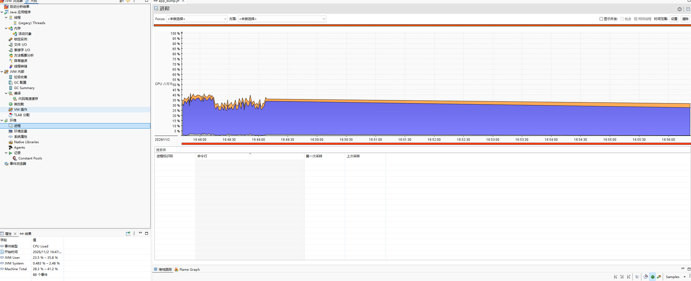
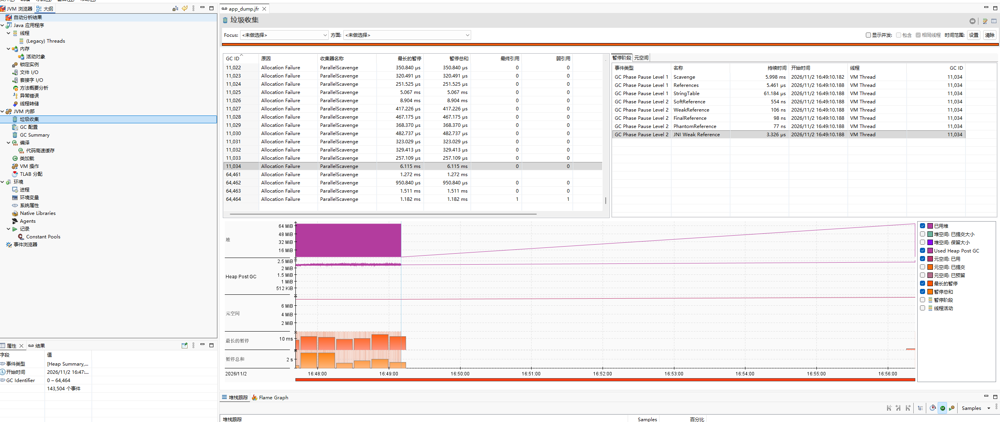

# 使用
通常生产常开（开销不大）  

java -Xms200M -Xmx200M -XX:StartFlightRecording=filename=/usr/project/app.jfr,maxsize=1G,maxage=24h,settings=default -jar gc_demo-1.0-SNAPSHOT.jar gc

常用参数
- filename	    输出 .jfr 文件路径
- duration	    录制时长，如 60s、5m
- delay        延迟多久开始录制
- settings	    配置文件，如 default、profile、verbose
- maxsize	    最大文件大小，如 1GB、2MB
- maxage        最大文件保存时间，如 1h、2d
- dumponexit    退出时自动 dump

# 分析
最推荐用 JDK Mission Control 打开 .jfr 文件，可以看 GC、线程、锁竞争、内存分配、方法热点等视图。  
命令行也可以快速查看：
```bash
#先确认录制是否在跑
jcmd 8950 JFR.check

#手动 dump 一次，验证文件
jcmd 8950 JFR.dump filename=/usr/project/app_dump.jfr

# 概览
jfr summary app.jfr

# 打印事件
jfr print app.jfr

# 只看 GC 事件
jfr print --categories GC app.jfr

# 导出 JSON
jfr print --json app_dump.jfr > app.json

# 导出 xml
jfr print --xml app.jfr > report.xml
```

| 事件类型 | 次数 | 说明 |
|---|---|---|
| `jdk.YoungGarbageCollection` | 11039 | Young GC 非常频繁 |
| `jdk.GCPhasePause` | 11039 | 每次 Young GC 都伴随暂停 |
| `jdk.GCPhasePauseLevel1` | 33116 | GC 子阶段暂停很多 |
| `jdk.GCPhasePauseLevel2` | 55193 | 更细粒度的 GC 暂停 |
| `jdk.GCHeapSummary` | 22078 | 堆状态变化非常频繁 |
| `jdk.ExecutionSample` | 3527 | CPU 采样数据已有，可查热点 |


# JMC安装
## 下载  
www.oracle.com/java/technologies/jdk-mission-control.html  

## 解压
解压之后，编辑同目录的 jmc.ini，在开头加一行指定 JDK：
```ini
-vm
D:/Program Files/Java/jdk-21.0.12.1/bin
```


## 分析
### 看cpu


### 看GC
```txt
1.收集器名称
ParallelScavenge表示Young GC
2.原因 
Allocation Failure（分配失败）Eden 区满了
3.紫色区域（已用堆）：这是最核心的曲线。它呈现典型的 “锯齿状”
中间的浅色线（Used Heap Post GC）：这是 GC 完之后存活的对象大小
```



