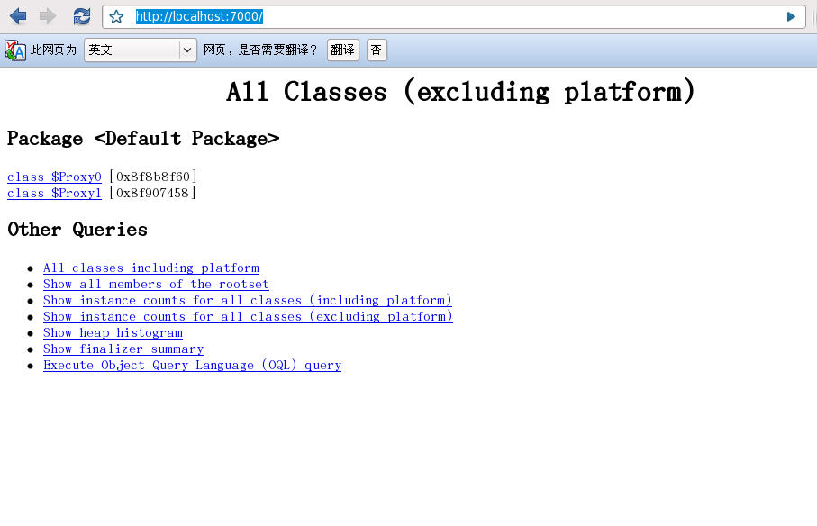
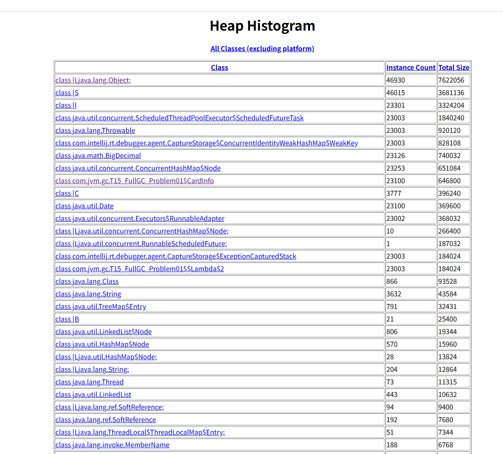
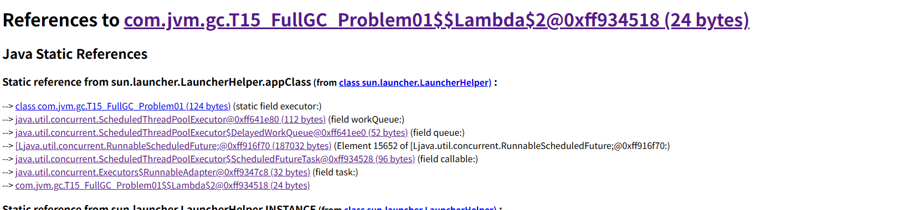

1. java -Xms200M -Xmx200M -XX:+PrintGC com.jvm.gc.T15_FullGC_Problem01
2. 一般是运维团队首先受到报警信息（CPU Memory）
3. top命令观察到问题：内存不断增长 CPU占用率居高不下
4. top -Hp 观察进程中的线程，哪个线程CPU和内存占比高
5. jps定位具体java进程  
   jstack 定位线程状况，重点关注：WAITING BLOCKED  
   eg.  
   waiting on <0x0000000088ca3310> (a java.lang.Object)  
   假如有一个进程中100个线程，很多线程都在waiting on<xx> ，一定要找到是哪个线程持有这把锁  
   怎么找？搜索jstack dump的信息，找<xx> ，看哪个线程持有这把锁RUNNABLE  
   作业：1：写一个死锁程序，用jstack观察 2 ：写一个程序，一个线程持有锁不释放，其他线程等待  
6. 为什么阿里规范里规定，线程的名称（尤其是线程池）都要写有意义的名称  
   怎么样自定义线程池里的线程名称？（自定义ThreadFactory）
7. jinfo pid
8. jstat -gc 动态观察gc情况 / 阅读GC日志发现频繁GC / arthas观察 / jconsole/jvisualVM/ Jprofiler（最好用）  
    jstat -gc 4655 500 : 每个500个毫秒打印GC的情况  
    如果面试官问你是怎么定位OOM问题的？如果你回答用图形界面（错误）  
    1：已经上线的系统不用图形界面用什么？（cmdline arthas）  
    2：图形界面到底用在什么地方？测试！测试的时候进行监控！（压测观察）
9. jmap - histo 4655 | head -20，查找有多少对象产生
10. jmap -dump:format=b,file=xxx pid ：  
    线上系统，内存特别大，jmap执行期间会对进程产生很大影响，甚至卡顿（电商不适合）  
    1：设定了参数HeapDump，OOM的时候会自动产生堆转储文件（不是很专业，因为多有监控，内存增长就会报警）  
    2：很多服务器备份（高可用），停掉这台服务器对其他服务器不影响  
    3：在线定位(一般小点儿公司用不到)  
    4：在测试环境中压测（产生类似内存增长问题，在堆还不是很大的时候进行转储）  
11. java -Xms20M -Xmx20M -XX:+UseParallelGC -XX:+HeapDumpOnOutOfMemoryError com.mashibing.jvm.gc.T15_FullGC_Problem01
12. 使用MAT / jhat /jvisualvm 进行dump文件分析https://www.cnblogs.com/baihuitestsoftware/articles/6406271.html  
    jhat -J-Xmx512M xxx.dump http://192.168.17.11:7000  
    拉到最后：找到对应链接  
    可以使用OQL查找特定问题对象  
13. 找到代码的问题

# jhat命令使用
使用jmap等方法生成java的堆文件后，使用其进行分析。
## 第一步：导出堆
#jmap -dump:live,file=a.log pid  
除了使用jmap命令，还可以通过以下方式：  
```text
1、使用 jconsole 选项通过 HotSpotDiagnosticMXBean 从运行时获得堆转储（生成dump文件）、
2、虚拟机启动时如果指定了 -XX:+HeapDumpOnOutOfMemoryError 选项, 则在抛出 OutOfMemoryError 时, 会自动执行堆转储。
3、使用 hprof 命令
```


## 第二步：分析堆文件
#jhat -J-Xmx512M java_pid14952.hprof  
说明：有时dump出来的堆很大，在启动时会报堆空间不足的错误，可加参数：jhat -J-Xmx512m <heap dump file>。这个内存大小可根据自己电脑进行设置。  
解析Java堆转储文件,并启动一个 web server


## 第三步：查看html
http://localhost:7000/


## 分析


1. 实例数量大致相同的：23301  为一组相互关联的对象
2. 找到业务对象
3. 点详情
4. 追 References to this object
```text
`References to this object` = 谁引用了这个对象（GC Roots → 这条引用链，就是泄漏元凶！）
`References from this object` = 这个对象持有哪些其他对象
```
5. 如果没找到就Exclude weak refs

