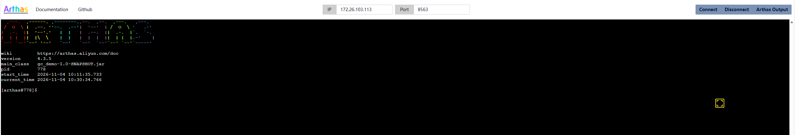
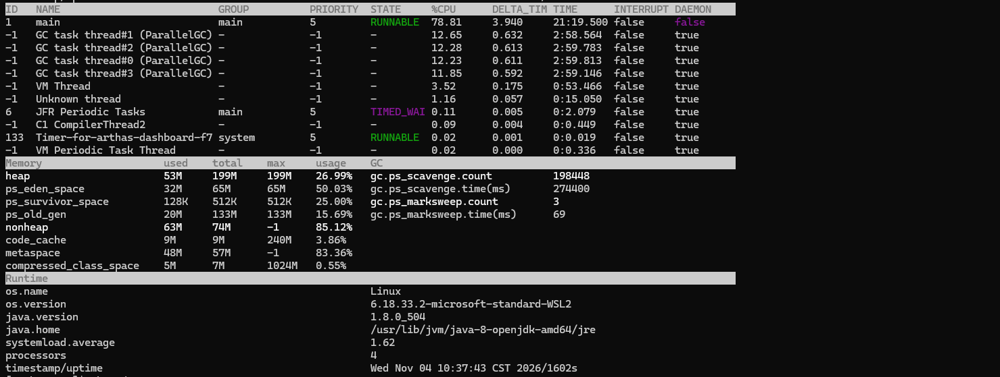
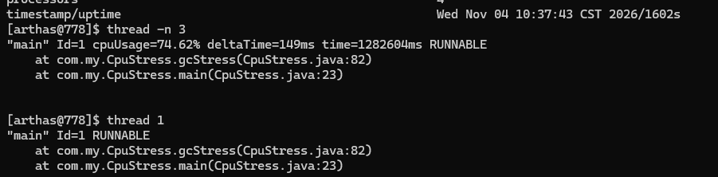

# 下载
https://maven.aliyun.com/repository/public/com/taobao/arthas/arthas-packaging/4.3.5/arthas-packaging-4.3.5-bin.zip  
https://github.com/alibaba/arthas/releases

# 启动
## 启动程序
java -Xms200M -Xmx200M -XX:StartFlightRecording=filename=/usr/project/app.jfr,maxsize=1G,maxage=24h,settings=default,dumponexit=true -jar gc_demo-1.0-SNAPSHOT.jar gc
## 启动arthas（wsl上面绑定ip）
java -jar arthas-boot.jar --target-ip 0.0.0.0 --username admin --password 123456
## 验证绑定
ss -tlnp | grep 8563
## 访问页面
http://172.26.103.113:8563/  


# 命令
| 命令 | 用途 |
|---|---|
| `dashboard` | 实时查看 CPU、线程、内存、GC |
| `jvm` | 查看 JVM 基本信息 |
| `memory` | 查看堆、非堆、各代内存使用情况 |
| `thread -n 3` | 查看 CPU 占用最高的线程 |
| `thread -b` | 查找死锁线程 |
| `heapdump /tmp/dump.hprof` | 生成堆转储文件 |
| `sc -d 类名` | 查看类加载信息 |
| `jad 类名` | 反编译已加载类源码 |
| `watch 类 方法 '{params,returnObj,throwExp}'` | 观测方法入参、返回值、异常 |
| `trace 类 方法` | 追踪方法调用链路和耗时 |
| `stack 类 方法` | 查看方法调用栈 |
| `monitor -c 5 类 方法` | 统计方法调用次数、耗时 |
| `profiler start/stop` | 生成火焰图 |
| `logger` | 查看/修改日志级别 |
| `reset` | 重置被增强的类 |
| `stop` | 停止 Arthas 服务端 |

# 分析



| 指标 | 值 | 解读 |
|---|---|---|
| `gc.ps_scavenge.count` | **198448 次** | 运行仅 1602 秒（27分钟），平均每秒 Young GC 约 **124 次** |
| `gc.ps_scavenge.time(ms)` | 274400 ms | 累计 274 秒花在 Young GC 上，占总运行时间的 **17%** |
| `gc.ps_marksweep.count` | 3 次 | Full GC 才 3 次，说明 Old 区还扛得住 |

| 区域 | 使用率 | 评价 |
|---|---|---|
| heap | 26.99% (53M/199M) | ✅ 健康 |
| ps_eden_space | 50.03% | ✅ 正常 |
| ps_old_gen | 15.69% | ✅ 正常，没有老年代堆积 |
| metaspace | 83.36% (48M/57M) | ⚠️ 偏高，持续观察，如果继续涨可能触发 Full GC |

1. 先看是谁在疯狂造对象——抓热点线程
```bash
thread -n 3
```
2. 看 main 线程具体在跑什么代码
```bash
 trace <main线程所在的类名> <方法名>
```
3. 如果怀疑某个方法在循环里疯狂 new 对象
```bash
profiler start
# 跑 30 秒后
profiler stop 

```

